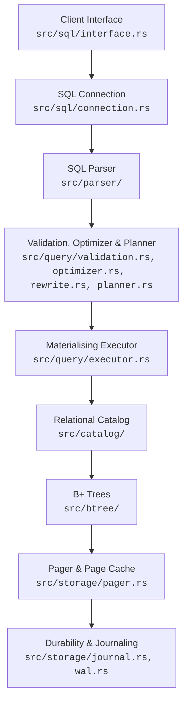

# Hematite Architectural Guide

Hematite is an embeddable, transactional SQL database engine written in Rust. It is designed to serve both as a functional embedded storage manager and as an educational reference for database design.

The system relies on a unidirectional layered architecture, where high-level SQL components translate logical commands into physical operations on a B-tree-backed page store.

---

## 1. Subsystem Layers and Unidirectional Flow

Hematite is structured into distinct layers. Dependencies flow strictly from top (client interface) to bottom (OS filesystem):



### Layer Responsibilities

1. **Client Interface (`sql::interface`, `sql::result`)**: Exposes the user-facing API: `Hematite`, `ResultSet`, `Row` and `FromRow`. `Transaction` and `PreparedStatement` live beside the connection they borrow.
2. **SQL Connection (`sql::connection`)**: Manages session state: autocommit, explicit transactions, the savepoint stack, and statement dispatch. Transaction control (`BEGIN`, `COMMIT`, `ROLLBACK`, savepoints) and introspection (`EXPLAIN`, `SHOW`, `DESCRIBE`) are handled here; everything else goes through the query pipeline.
3. **SQL Parser (`parser`)**: Lexes text into span tokens and parses them with a hand-written recursive-descent parser into a flat arena (`parser::arena::Ast`). The query layer still reads the owned tree in `parser::ast`, which `parser::bridge` materialises from the arena after every parse.
4. **Validation, Optimizer & Planner (`query`)**: `QueryPlanner::plan` validates the statement against the schema (`validation`), folds constants (`optimizer`), normalises structure (`rewrite`), and chooses an access path per source with a `LogEst` cost (`planner`). The result is a `QueryPlan` wrapping an `ExecutionProgram`.
5. **Query Executor (`query::executor`)**: Interprets the planned statement. Execution materialises rather than pipelines: each step of a `SELECT` — read, filter, sort, group, project, limit — takes a `Vec` of rows and produces the next. Joins are nested loops. Writes check constraints and foreign keys and maintain indexes.
6. **Relational Catalog (`catalog`)**: Owns the schema and maps tables and indexes onto B-trees. Rows are stored as self-describing records with a variable-width serial-type header (`record_codec`); index keys use a separate order-preserving encoding (`index_key_codec`).
7. **B+ Trees (`btree`)**: Slotted-page interior and leaf nodes over opaque byte keys and values. Most inserts, updates and deletes edit a page in place; splits, merges and borrows decode it. Values larger than 1001 bytes spill into overflow chains, and `compaction` relocates pages for auto-vacuum.
8. **Pager (`storage::pager`)**: The page cache, page allocation and the free list, dirty-page tracking, savepoints, page-trailer checksums, and in-process locking.
9. **Journaling (`storage::journal` & `storage::wal`)**: Crash safety, by either an undo (rollback) journal or a redo write-ahead log.

---

## 2. Query Lifecycle Dataflow

Below is the lifecycle of a `SELECT` that can use a secondary index:

```mermaid
sequenceDiagram
    autonumber
    actor Client as Client Connection<br>"SELECT name FROM users WHERE age = 30;"
    participant Parser as Parser<br>[Ast → Statement]
    participant Planner as Planner<br>[QueryPlan]
    participant Executor as Executor<br>[SelectExecutor]
    participant Catalog as Catalog / B-Tree / Pager

    Client->>Parser: parse_sql_statement()
    Parser->>Planner: QueryPlanner::plan()
    Planner->>Executor: build_executor()
    Executor->>Catalog: lookup_rows_by_secondary_index()
    Note over Catalog: Descend the index tree for age = 30,<br>then fetch each row by row id
    Catalog-->>Executor: Vec of decoded rows
    Note over Executor: Apply WHERE, project "name"
    Executor-->>Client: QueryResult
```

1. **Parse**: The text is tokenized and parsed. Keywords must be uppercase; a lowercase one is rejected with a "must be capitalized" error. The result is a `Statement::Select`.
2. **Plan**: The statement is validated against the schema (the table `users` and the columns `name` and `age` must exist), constants are folded, and the planner sees an equality on an indexed column and chooses `SecondaryIndexLookup`.
3. **Execute**: `SelectExecutor` asks the catalog for the rows matching `age = 30`. The catalog descends the index B-tree to collect matching row ids, then looks each row up in the table B-tree and decodes its record.
4. **Read pages**: Each tree descent asks the pager for pages, which come from the page cache or are read from the file and have their trailer checksum verified.
5. **Project & Emit**: The executor applies the full `WHERE`, projects `name`, and returns a `QueryResult`, which `Hematite::query` hands back as a `ResultSet`.

---

## 3. Concurrency Model

Hematite is single-writer / multiple-reader **within one process**. Two processes opening the same database is not supported. Handles on the same database coordinate through a process-wide registry keyed by the file's path (`storage/pager/locking.rs`): a mutex and condition variable, so a blocked writer wakes as soon as the lock frees, and gives up after five seconds.

Hematite supports two journal modes: **Rollback Journaling** (the default) and **Write-Ahead Logging (WAL)**.

### Rollback Journal Mode

Modifications are written in place to the main database file. Before a page is first modified, its original content is copied to the rollback journal (`<db>.journal`).

* **Locking**: Readers and the writer share one lock, because a reader of a file being written in place would see half a transaction.
* **Commit**: The journal is fsynced, then the dirty pages are written to the database and it is fsynced — two fsyncs per commit. The journal is then emptied, not deleted.
* **Rollback & Recovery**: `ROLLBACK` restores the journalled pages. At open, an active journal is checked against the commit intents it records: if every page already holds its post-commit contents, the commit landed and the journal is discarded; otherwise the original pages are copied back.

### WAL Mode

Updates are not written in place. A commit appends its modified pages as frames to the write-ahead log (`<db>.wal`) and fsyncs the WAL — one fsync per commit, and the database file is not touched.

* **Reader Isolation**: Readers take no lock. A reader registers the commit it is reading at; when it needs page `N`, the pager uses the newest frame for `N` at or before that commit, or the main database file if the WAL has none.
* **Writer Flow**: The writer has its own lock and appends frames to the end of the WAL; it never blocks readers.
* **Commit boundary**: A commit's frames share a commit sequence and end with a frame for page 1. A run without one is an incomplete commit and is ignored on load.
* **Checkpointing**: Once the WAL holds 1000 frames (or on `checkpoint_wal`, or on switching back to rollback mode), every page the WAL overrides is written to the database, the database is fsynced, and the WAL is deleted.

#### Comparison: Hematite vs. SQLite Concurrency

| Feature | SQLite Concurrency | Hematite Concurrency |
| --- | --- | --- |
| **Locking Mechanism** | OS-level file locks (Shared, Reserved, Pending, Exclusive) | In-memory locks in a process-wide registry, keyed by database path |
| **Concurrency Limit** | Multiple reader processes, single writer process | Multiple readers, single writer, all within one process |
| **Commit Boundary** | WAL frame with a non-zero database size | Group of frames sharing a commit sequence and ending with page 1 |

---

## 4. File and Physical Page Layout

Unlike SQLite, which places the database header and the schema root together on its first page, Hematite separates the database header, transaction metadata, and allocatable B-tree pages.

### Physical Layout of a Hematite Database File

| Page 0<br>**Database Header** | Page 1<br>**Storage Metadata** | Page 2+<br>**Allocatable Trees** |
| :--- | :--- | :--- |
| 100 bytes reserved | Magic `HMD1` | Slotted Pages |

* **Page 0 (`DB_HEADER_PAGE_ID`)**: The first 100 bytes are reserved. A 20-byte database header is written at the start, containing: magic code `HMTD` (4 bytes), format version `1` (4 bytes), schema B-tree root page ID (4 bytes), next table ID (4 bytes), and header checksum (4 bytes). All header integers are little-endian. The remaining 80 bytes are zero padding. Page size is a compile-time constant (`4096`), not stored in the header.
* **Page 1 (`STORAGE_METADATA_PAGE_ID`)**: A metadata container starting with the magic `HMD1`. It holds the pager's section (journal mode and free page list) and the catalog's (per-table root page, row count, and next row id).
* **Page 2 and onwards (`FIRST_ALLOCATABLE_PAGE_ID`)**: Allocated for the schema tree, table B-trees, index B-trees, and overflow page chains.
* **Every page's last 4 bytes** (`PAGE_TRAILER_SIZE`) belong to the pager, which stamps a checksum of that page's own contents there. Nothing above the pager writes into them, so a page has 4092 usable bytes. A checksum stored on the page it describes has no ceiling on how many pages it can cover.

`docs/storage-format-spec.md` gives every byte layout.

---

## 5. ACID Guarantees

* **Atomicity**: In rollback mode, a page's original image is in the journal before the page is overwritten, and the journal is fsynced before any commit writes reach the database; a crash mid-commit is rolled back at open unless the commit intents show it landed. In WAL mode, a commit counts only once its closing page-1 frame is in the log; a partial commit is ignored.
* **Consistency**: `CHECK`, `NOT NULL`, uniqueness and foreign-key constraints are checked on every row a statement writes, before the row is written.
* **Isolation**: Writers are serialized by the write lock. In rollback mode readers wait for the writer, so they never see a partial transaction; in WAL mode each reader sees the database as of the commit it started at.
* **Durability**: A commit returns after its fsyncs: two in rollback mode (journal, then database), one in WAL mode (the WAL). The database file is fsynced again at each checkpoint.

---

## 6. Design Intent

Hematite is built with the following core design guidelines:

* **Understandability over Complexity**: The codebase prefers direct, clear code paths. Simplifications are embraced where they do not hurt correctness or safety (e.g. unified decimal numeric calculations, and a compact type system with no temporal, fixed-length, or enumerated types).
* **Strict Dialect & Case Enforcement**: Enforcing uppercase keywords keeps parsing deterministic, preventing complex and fragile grammar ambiguity rules.
* **Educational Architecture**: By maintaining clean boundaries between the logical query layer, the physical catalog manager, and the low-level storage engines, developers can learn B-tree internals and physical SQL engine query flow directly from the codebase.
