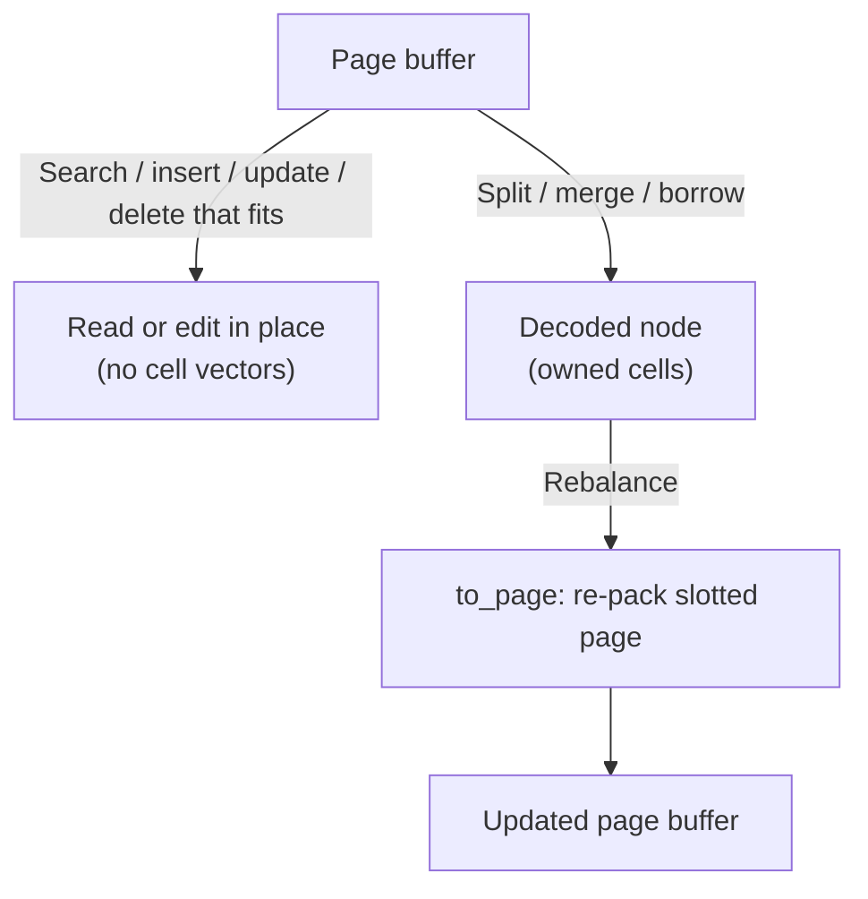

# Hematite Codebase Guide

This document is a map of the Hematite codebase: where each component lives, how the layers hand work to one another, and what to touch when extending the engine.

---

## 1. Directory and Submodule Architecture

The codebase is organized into six layers, top to bottom:

```text
src/
├── main.rs                       # hematite_cli: REPL and one-shot script runner
├── lib.rs                        # Public API re-exports and crate docs
├── error.rs                      # HematiteError and Result
├── cli/                          # CLI argument parsing (and its tests)
├── test_utils.rs, tests.rs       # Shared test helpers; crate-level tests
│
├── sql/                          # 1. SQL Interface & Session Layer
│   ├── interface.rs              # Hematite facade, FromValue
│   ├── connection.rs             # Connection: autocommit, transactions, savepoints, dispatch;
│   │                             #   PreparedStatement, Transaction
│   ├── result.rs                 # ResultSet, Row, StatementResult, ExecutedStatement, FromRow
│   ├── script.rs                 # Script splitting (ScriptIter), script_is_complete
│   └── tests.rs                  # End-to-end SQL tests
│
├── parser/                       # 2. Lexer, Parser & AST
│   ├── lexer.rs                  # Span tokens (TokenKind + byte range); keyword classification
│   ├── parser.rs                 # Hand-written recursive-descent parser; builds into the arena
│   ├── arena.rs                  # Ast: the parsed statement as flat buffers addressed by u32 ids
│   ├── bridge.rs                 # Ast::to_owned_statement: arena → owned ast::Statement
│   ├── ast.rs                    # Owned AST the query layer reads (SelectStatement, etc.)
│   ├── types.rs                  # SqlTypeName, LiteralValue
│   └── tests.rs
│
├── query/                        # 3. Validation, Optimization, Planning & Execution
│   ├── validation.rs             # Name resolution and semantic checks against the schema
│   ├── optimizer.rs              # Constant folding and boolean simplification
│   ├── rewrite.rs                # HAVING→WHERE promotion, ORDER BY removal in FROM subqueries
│   ├── planner.rs                # QueryPlanner: access-path choice and cost
│   ├── plan.rs                   # QueryPlan, ExecutionProgram, SelectAccessPath, PlanNode (EXPLAIN)
│   ├── predicate.rs              # The column = literal equalities a WHERE guarantees
│   ├── logest.rs                 # LogEst logarithmic cost arithmetic (after SQLite)
│   ├── executor.rs               # One executor per statement kind; expression evaluation
│   ├── lowering.rs               # Parser literals and type names → catalog Values and DataTypes
│   ├── runtime.rs                # QueryResult, ExecutionContext, per-statement caches
│   ├── metadata.rs               # Result shapes for SHOW / DESCRIBE
│   └── tests.rs
│
├── catalog/                      # 4. Relational Schema & Row Storage
│   ├── catalog.rs                # Catalog: schema ownership, DDL, schema persistence
│   ├── schema.rs                 # Schema: tables by id and name (Arc<Table>)
│   ├── table.rs                  # Table: columns, keys, indexes, constraints
│   ├── column.rs                 # Column definitions, value validation, defaults
│   ├── types.rs                  # DataType, Value, DecimalValue
│   ├── engine.rs                 # CatalogEngine: the catalog's interface to B-trees and the pager
│   ├── table_store.rs            # Row reads, writes and scans on table trees
│   ├── index_store.rs            # Primary-key and secondary index maintenance and lookups
│   ├── record_codec.rs           # Row records: serial-type header + bodies; ProjectionPlan
│   ├── index_key_codec.rs        # Order-preserving index key encoding
│   ├── serialization.rs          # RowCodec / IndexKeyCodec names; row id keys
│   ├── schema_store.rs           # Schema persistence in the schema tree (__schema__ blob)
│   ├── engine_metadata.rs        # Catalog section of page 1 (root pages, row counts, next row id)
│   ├── runtime_metadata.rs       # In-memory per-table runtime metadata
│   ├── header.rs                 # Database header on page 0
│   ├── name_hash.rs              # Fast hasher for schema name maps
│   ├── integrity.rs              # Catalog integrity checks
│   ├── cursor.rs                 # Table and index cursors
│   ├── record.rs                 # StoredRow
│   ├── object.rs                 # Named constraints and other schema objects
│   ├── ids.rs                    # TableId, ColumnId
│   └── tests.rs
│
├── btree/                        # 5. B+ Trees
│   ├── mod.rs                    # Key/value types, BTREE_ORDER, re-exports
│   ├── bytes.rs                  # ByteTreeStore / ByteTree / ByteTreeCursor
│   ├── typed.rs                  # TypedTreeStore / TypedTree / TypedTreeCursor over a codec
│   ├── codec.rs                  # KeyValueCodec trait, RawBytesCodec
│   ├── node.rs                   # BTreeNode: page decoding and in-place mutation
│   ├── page_format.rs            # Slotted-page header, cell pointers, freeblocks, defragmentation
│   ├── index.rs                  # Insert, delete, split, borrow, merge
│   ├── cursor.rs                 # Stack-based cursor for seeks and scans
│   ├── tree.rs                   # Tree lifecycle: create, open, delete, reset, validate
│   ├── value_store.rs            # Inline vs. overflow stored values
│   ├── compaction.rs             # Page relocation for auto-vacuum
│   ├── varint.rs                 # Varints for records and index values
│   └── tests.rs
│
└── storage/                      # 6. Pager, Page Cache & Durability
    ├── types.rs                  # PAGE_SIZE, USABLE_PAGE_SIZE, PageId, Page, page buffer pool
    ├── format.rs                 # DATABASE_HEADER_SIZE, PageKind
    ├── file_manager.rs           # File I/O, page trailer stamping and verification, fsync
    ├── pager.rs                  # Pager: the struct and its public surface
    ├── pager/                    # Pager implementation, split by concern
    │   ├── cache.rs              # Page cache and eviction
    │   ├── core.rs               # Begin, commit, rollback
    │   ├── page_io.rs            # Page reads and writes, spilling, commit flush
    │   ├── reader.rs             # Read scopes
    │   ├── space.rs              # Page allocation and deallocation
    │   ├── savepoint.rs          # Savepoints
    │   ├── journal.rs            # Rollback-journal lifecycle
    │   ├── recovery.rs           # Journal records, commit intents, recovery at open, WAL commit
    │   ├── wal.rs                # WAL mode, checkpointing
    │   ├── locking.rs            # In-process reader/writer coordination
    │   ├── state.rs              # JournalMode, PagerState transitions
    │   ├── integrity.rs          # Pager integrity checks
    │   ├── test_support.rs, tests.rs
    ├── journal.rs                # Rollback journal format (HTJ1)
    ├── wal.rs                    # WAL file format (HTW1): frames, salts, commit groups
    ├── metadata_page.rs          # Page 1 container (HMD1)
    ├── pager_metadata.rs         # Pager section of page 1 (HPM1): journal mode, free list
    ├── free_list.rs              # The set of free pages
    ├── overflow.rs               # Overflow page chains
    ├── checksum.rs               # XXH64 and hash32
    ├── page_hash.rs              # Fast hasher for page-id maps
    ├── stats.rs                  # PagerStats work counters
    └── tests.rs

examples/                         # Profiling harnesses (scan, storage, wal, parse)
benches/                          # Criterion benchmarks
scripts/layer-attribution.sh      # Buckets callgrind cost by layer
```

---

## 2. Layer-by-Layer Subsystem Tour

### 1. SQL Layer (`src/sql/`)

The entry boundary for user queries. It coordinates session state and transaction boundaries.

* **`interface.rs`**: `Hematite`, the facade most users hold. It opens databases and offers `execute`, `query`, `query_as`, `prepare`, `transaction` and `execute_batch`.
* **`connection.rs`**: `Connection` runs one statement at a time. Outside an explicit transaction, a write runs in an implicit transaction of its own and a read in a read scope. `BEGIN`, `COMMIT`, `ROLLBACK` and `SAVEPOINT` / `ROLLBACK TO` / `RELEASE` manage explicit ones; a statement that fails inside a transaction does not end it.
* **`script.rs`**: splits a multi-statement script into statements over one token buffer, and answers `script_is_complete` — whether a buffer ends in a `;` outside a literal — with a byte scan, which the REPL asks after every line.

### 2. Parser Layer (`src/parser/`)

Translates SQL text into a statement the query layer can read.

* **`lexer.rs`**: produces tokens that are a `TokenKind` plus a byte range into the input, so lexing allocates nothing but the token buffer. Keywords are matched case-sensitively: `select` lexes as an identifier.
* **`parser.rs`**: a hand-written recursive-descent parser, one method per grammar rule and one per precedence level. It rejects a lowercase keyword with `Keyword 'select' must be capitalized as 'SELECT'`.
* **`arena.rs`**: the parser's output. A statement is a few flat buffers addressed by `u32` ids, and a name is a byte range into the SQL, so a node is small and `Copy`.
* **`bridge.rs` and `ast.rs`**: the query layer still reads the owned tree in `ast.rs`, so `parse_sql_statement` builds it from the arena. The bridge is transitional; it comes out when the query layer reads the arena directly.

### 3. Query Layer (`src/query/`)

Plans a statement and runs it.

* **`validation.rs`**: resolves table and column names against the schema and checks clause placement. It does not type-check operands.
* **`optimizer.rs` & `rewrite.rs`**: logical only. The optimizer folds constants in expression operands; the rewrite pass promotes eligible `HAVING` terms into `WHERE` and drops `ORDER BY` from `FROM` subqueries.
* **`planner.rs`**: chooses an access path per source — `RowIdLookup`, `PrimaryKeyLookup`, `SecondaryIndexLookup`, `FullTableScan` or `JoinScan` — with a `LogEst` cost, and wraps the statement in an `ExecutionProgram`.
* **`executor.rs`**: `build_executor` makes one executor per statement kind (`SelectExecutor`, `InsertExecutor`, `UpdateExecutor`, `DeleteExecutor`, and the DDL executors). Execution materialises: each step of a `SELECT` takes a `Vec` of rows and produces the next. Joins are nested loops. It also holds expression evaluation, aggregates, and value coercion.

### 4. Catalog Layer (`src/catalog/`)

Maps relational tables onto B-trees.

* **`catalog.rs`**: owns the schema and runs DDL.
* **`engine.rs`**: `CatalogEngine`, the only path from the query layer to storage. It trades in `Value`s and row ids.
* **`record_codec.rs`**: rows are self-describing records: a varint header of serial types, each giving a column's type and width, then the bodies. `ProjectionPlan` reuses one decoded header layout across rows that share it.
* **`index_key_codec.rs`**: index keys sort as byte strings in the same order as the values they encode.
* **`types.rs`**: `DataType`, `Value`, and `DecimalValue` arithmetic.

### 5. B-Tree Layer (`src/btree/`)

B+ trees over opaque byte keys and values.

* **`node.rs` & `page_format.rs`**: slotted pages, where cells grow down from the end of the usable area and cell pointers grow up after the header. Lookups read the page in place; most inserts, updates and deletes edit it in place, and only splits, merges and borrows decode it.
* **`cursor.rs`**: walks leaves forward and backward for seeks and range scans.
* **`value_store.rs`**: a value over 1001 bytes keeps 32 bytes in the cell and spills the rest to overflow pages. Keys never spill; they are capped at 256 bytes.

### 6. Storage Layer (`src/storage/`)

Files, the page cache, and durability.

* **`pager.rs`**: the page cache, dirty-page tracking, page allocation, savepoints, and database-level locking.
* **`journal.rs` & `wal.rs`**: the undo journal and the redo log. In rollback mode the journal is fsynced before the database is written; in WAL mode a commit only appends to and fsyncs the WAL.
* **`file_manager.rs`**: page I/O, stamping a checksum into every page's 4-byte trailer and verifying it on read.
* **`free_list.rs`**: the set of free pages, recycled before the file grows.
* **`overflow.rs`**: overflow page chains for values too large to keep in a cell.

---

## 3. Developer Extension Guides

### How to Add New SQL Syntax

1. **Lexer (`src/parser/lexer.rs`)**:
   * Add any new keyword to `TokenKind` and to the `classify_identifier` match (keywords are uppercase).
   * In `parser.rs`, add it to `ALL_UPPERCASE_KEYWORDS` and `token_keyword_name` so a lowercase spelling gets the "must be capitalized" diagnostic, and to `TOP_LEVEL_KEYWORDS` if it starts a statement.
2. **Arena (`src/parser/arena.rs`)**:
   * Add a variant to the arena `Statement`. If it needs a parts struct, give it an id with `arena_id!`, a buffer with `arena_buffer!`, a field on `Ast`, and a `.clear()` in `Ast::reset`.
3. **Parser (`src/parser/parser.rs`)**:
   * Route to a new `parse_*` method from `Parser::parse`. Every statement rule consumes its trailing `;`.
4. **Owned AST and bridge (`src/parser/ast.rs`, `src/parser/bridge.rs`)**:
   * Add the owned `ast::Statement` variant and its structs, and an arm in `owned_statement` that builds it from the arena.
5. **Validation (`src/query/validation.rs`)**:
   * Add an arm to `validate_statement` and a `pub(crate) fn validate_*` for the executor to call.
6. **Planning (`src/query/planner.rs`, `src/query/plan.rs`)**:
   * Add an `ExecutionProgram` variant, a `plan_*` method and its arm in `plan_validated`, and a `PlanNode` variant with its arm in `QueryPlan::node` for `EXPLAIN`.
7. **Execution (`src/query/executor.rs`)**:
   * Add an executor implementing `QueryExecutor::execute`, validating its statement first, and route the program to it in `build_executor`.

Transaction-control and introspection statements skip steps 5–7: `Connection::execute_statement` handles them directly.

### How to Add a Built-in SQL Scalar Function

1. **AST (`src/parser/ast.rs`)**:
   * Add a `ScalarFunction` variant and its name to `ScalarFunction::from_identifier`, which matches case-insensitively. No parser change is needed unless the name is also a lexer keyword, like `LEFT` and `RIGHT` (see `parse_scalar_function_name`).
2. **Executor (`src/query/executor.rs`)**:
   * Add an arm to `evaluate_scalar_function`. Arity and argument types are checked here, at evaluation, by the `expect_*` helpers; validation only recurses into the arguments.
3. **Tests**:
   * Add a case in `src/query/tests.rs` or `src/sql/tests.rs` that runs it through SQL.

### How to Add a New Runtime Type

1. **Parser (`src/parser/types.rs`, `lexer.rs`, `parser.rs`)**:
   * Add the type to `SqlTypeName`, a `TokenKind` and `classify_identifier` arm for its keyword, a branch in `parse_data_type`, and entries in `DATA_TYPE_KEYWORDS`, `ALL_UPPERCASE_KEYWORDS` and `token_keyword_name`.
2. **Catalog types (`src/catalog/types.rs`)**:
   * Add the `DataType` and the `Value` variant.
3. **Encodings**:
   * Records (`src/catalog/record_codec.rs`): its serial-type code or range, and the arms in `serial_type`, `encode_into`, `classify` and `value_from_body`.
   * Index keys (`src/catalog/index_key_codec.rs`): a tag and an `encode_value` arm that preserves its sort order.
   * Schema (`src/catalog/column.rs`): how the column's type is written to and read from the schema blob.
4. **Lowering and evaluation (`src/query/lowering.rs`, `src/query/executor.rs`)**:
   * Map the type name and literals into it, and add comparison, sorting and cast support.
5. **Tests**:
   * Add round-trip tests in `src/catalog/tests.rs` and SQL tests in `src/sql/tests.rs`.

### How to Add a Metadata Command

1. **Syntax**: add the statement through steps 1–4 of "How to Add New SQL Syntax".
2. **Result shape (`src/query/metadata.rs`)**:
   * Add a function that returns the column names and rows of the answer.
3. **Connection (`src/sql/connection.rs`)**:
   * Handle the statement in `Connection::execute_statement`, reading the active schema.

---

## 4. B-Tree Node Decoding and Traversal

B-tree nodes are pages. To avoid allocating on every lookup, Hematite reads nodes in place and decodes one only when a structural change needs it.

### Descending to a Key

```text
Cursor seek (search key K)
======================================================
1. Start at the root page id (from the catalog).
2. Fetch the page from the pager (shared, not copied).
3. Wrap it with BTreeNode::from_shared_page — this reads the header
   but builds no vector of cells.
4. Binary-search the cell pointers in the page buffer.
5. Interior node: follow the child page id for K, and repeat from 2,
   pushing a frame onto the cursor's stack.
6. Leaf node: the cursor's top frame holds this page and the cell index.
```

### When a Node Is Decoded

* **`BTreeNode` (`src/btree/node.rs`)** holds the page and its parsed header. Keys and values are read straight out of the page bytes.
* **In-place edits**: most inserts, updates and deletes change the page directly (`try_insert_leaf_in_place`, `try_update_leaf_in_place`, `try_remove_cell_in_place`, `rotate_leaf_cell`).
* **Decoding**: a split, a merge, an interior borrow, or a fallback when an in-place edit does not fit decodes the node into owned cells, rebalances, and writes it back with `to_page`.


