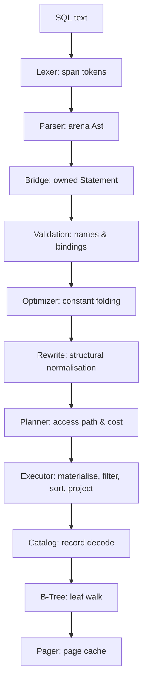

# Query Execution Walkthrough

This document traces one SQL query through the Hematite engine, from raw text to the rows it returns, naming the function that does each step so you can follow along in the code.

We will trace this query:

```sql
SELECT name, age FROM users WHERE age > 18 ORDER BY age;
```

against a table with no index on `age`:

```sql
CREATE TABLE users (id INT PRIMARY KEY, name TEXT, age INT);
```

---

## 1. Subsystem Execution Path



`Connection::execute` (`src/sql/connection.rs`) drives the whole thing: it parses, and `execute_statement` hands the statement to `QueryPlanner::plan`, builds an executor from the plan and runs it.

---

## 2. Phase 1: Lexing & Parsing (`src/parser`)

1. **Lexer (`lexer.rs`)** turns the text into tokens:
   `SELECT`, `name`, `,`, `age`, `FROM`, `users`, `WHERE`, `age`, `>`, `18`, `ORDER`, `BY`, `age`, `;`.
   A token is a `TokenKind` plus a byte range into the input. It owns no text, so it is `Copy` and 12 bytes.
2. **Parser (`parser.rs`)** is hand-written recursive descent, one method per grammar rule and one per precedence level. It builds the statement into an arena (`arena.rs`): flat buffers addressed by `u32` ids, with names stored as byte ranges into the SQL itself, so a node is small and `Copy` and the tree costs a handful of allocations rather than one per node.
   * **Keyword casing**: keywords are matched case-sensitively, so `select` lexes as an identifier. The parser notices an identifier where a keyword belongs and rejects the query with `Keyword 'select' must be capitalized as 'SELECT'`.
3. **Bridge (`bridge.rs`)**: the query layer still reads the owned tree in `ast.rs`, so `parse_sql_statement` materialises one from the arena with `Ast::to_owned_statement`. The bridge is transitional; it goes once the query layer reads the arena directly.

The owned statement for our query is `Statement::Select(SelectStatement { .. })`:

```text
SelectStatement
├── columns:        [SelectItem::Column("name"), SelectItem::Column("age")]
├── column_aliases: [None, None]
├── from:           TableReference::Table("users", None)
├── where_clause:   Some(WhereClause {
│                     conditions: [
│                       Expression::Comparison {
│                         left:     Expression::Column("age"),
│                         operator: ComparisonOperator::GreaterThan,
│                         right:    Expression::Literal(LiteralValue::Integer(18)),
│                       }
│                     ]
│                   })
└── order_by:       [OrderByItem { column: "age", direction: SortDirection::Asc }]
```

(`with_clause`, `group_by`, `having_clause`, `limit`, `offset` and `set_operation` are empty.)

---

## 3. Phase 2: Validation (`src/query/validation.rs`)

The tree holds only names. `validate_statement`, called first thing in `QueryPlanner::plan`, checks them against the schema:

1. **Table existence**: is there a table `users`?
2. **Column binding**: do `name` and `age` resolve to exactly one source, without ambiguity?
3. **Clause placement**: aggregates, `GROUP BY` and `HAVING` are where SQL allows them.

Validation does not type-check operands. `age > 18` is not checked for compatible types here; values are compared and coerced when the executor evaluates them.

---

## 4. Phase 3: Optimization and Rewrites (`src/query/optimizer.rs`, `rewrite.rs`)

`QueryOptimizer` folds constants: had the query said `WHERE age > 10 + 8`, the operand `10 + 8` would become the literal `18`. It works on expression *operands*, not on a condition's own top level: `WHERE age > 18 AND TRUE` stays as written, and `WHERE 1 = 1` is not folded away. The module doc lists every rule.

`rewrite_select` then normalises structure: it promotes `HAVING` terms that depend only on `GROUP BY` expressions or constants into `WHERE`, and drops `ORDER BY` from subqueries in `FROM`. Neither applies to our query.

---

## 5. Phase 4: Planning (`src/query/planner.rs`)

The planner chooses an access path for each source and estimates a cost in `LogEst` (a logarithmic estimate, after SQLite's). The candidates are `RowIdLookup`, `PrimaryKeyLookup`, `SecondaryIndexLookup` and `FullTableScan`; an equality on a primary key or an indexed column makes a lookup possible.

`age > 18` is a range on an unindexed column, so the plan is a `FullTableScan`. The result is a `QueryPlan` wrapping an `ExecutionProgram` — the optimised statement plus that access path. There is no tree of physical operators: the executor interprets the statement directly.

`EXPLAIN SELECT …` stops here and returns two rows, the plan's `PlanNode` description and its `estimated_cost`.

---

## 6. Phase 5: Execution (`src/query/executor.rs`)

`build_executor` turns the program into a `SelectExecutor`, and `SelectExecutor::execute` runs it. Execution **materialises rather than pipelines**: each step takes a `Vec` of rows and produces the next one. `execute_body` runs these steps in order:

1. **Fast path check.** `try_direct_projection` answers a plain `SELECT a, b FROM t` by decoding only the projected columns. Our query has a `WHERE` and an `ORDER BY`, so it does not qualify.
2. **Read the source.** `materialize_filtered_rows` reads the table by its access path. For a full scan that is `CatalogEngine::read_from_table`, which walks the table B-tree's leaves in row-id order (`src/btree`, through the pager's page cache in `src/storage`), decodes each record with `src/catalog/record_codec.rs`, and returns every row as a `Vec<Value>`.
3. **Filter.** `filter_source_rows` evaluates `age > 18` against each row and keeps the ones that pass.
4. **Sort.** The query has an `ORDER BY` and no grouping, so the filtered rows are sorted by `age` before projection.
5. **Project.** `project_row` keeps `name` and `age` from each row.
6. **Window.** `apply_select_window` applies `DISTINCT`, `OFFSET` and `LIMIT`, none of which are present here.

The result is a `QueryResult` (`src/query/runtime.rs`): column names plus every row's values laid end to end in one buffer. `Hematite::query` wraps it in a `ResultSet`, whose `Row`s borrow from that buffer.

Had the query asked `WHERE id = 7`, or `WHERE age = 30` with an index on `age`, the planner would have chosen a lookup and step 2 would have descended the B-tree once instead of scanning it.
